# Till user guide

How to use the pharmacy till: setting it up, products and stock, shifts, selling, returns,
staff and settings. It is written for the people at the counter (owner, pharmacists and
cashiers) and describes the till as it is built today.

RxPoint is a working name and will change. The screenshots come from a test pharmacy
("Shifa Pharmacy") with the sample stock list, so the names and prices are made up.

**Not built yet:** receipt printing and the cash drawer (receipts are shown on screen, and
the drawer is opened by hand), khata (customer credit), purchasing from distributors and
reports. No printer or scanner is needed to use the till: typing a barcode and pressing
Enter works the same as scanning it.

## Contents

1. [A day at the till](#1-a-day-at-the-till)
2. [Keyboard shortcuts](#2-keyboard-shortcuts)
3. [First-time setup](#3-first-time-setup)
4. [Logging in, locking and PINs](#4-logging-in-locking-and-pins)
5. [Staff and roles](#5-staff-and-roles)
6. [Shifts and the cash drawer](#6-shifts-and-the-cash-drawer)
7. [Selling](#7-selling)
8. [Paying](#8-paying)
9. [Controlled drugs and prescriptions](#9-controlled-drugs-and-prescriptions)
10. [Holding a sale](#10-holding-a-sale)
11. [Sales list, voids and returns](#11-sales-list-voids-and-returns)
12. [Products](#12-products)
13. [Stock and expiry](#13-stock-and-expiry)
14. [Importing a product list](#14-importing-a-product-list)
15. [Settings](#15-settings)
16. [Backups](#16-backups)
17. [Rules at a glance](#17-rules-at-a-glance)
18. [Messages you may see](#18-messages-you-may-see)
19. [Known issues](#19-known-issues)
20. [Updating this guide](#20-updating-this-guide)

---

## 1. A day at the till

1. **Log in:** pick your name and type your PIN.
2. **Open the shift:** on **Shift**, count the cash in the drawer and press **Open shift**.
3. **Sell:** on **Sale**, scan or type each item, then press **F9** to take payment.
4. **During the day:** use **F8** to hold a sale for a customer who steps away, **Sales**
   to show a receipt again, void a sale or take items back, and **Cash in/out** (Alt+C)
   for money put into or taken from the drawer. **F1** lists every key.
5. **Leaving the till:** press **Ctrl+L** to lock it. It also locks itself after 5 idle
   minutes.
6. **Close the shift:** on **Shift**, press **Close shift**, count the drawer, and keep the
   shift report.

## 2. Keyboard shortcuts

Every action also has a button. Press **F1**, or **Keys** at the bottom left, to see the
keys on screen. The scanner types like a keyboard and presses Enter, so anything below
that says "type and press Enter" also works with a scan. When a dialog opens, the cursor
is already in its first box (Cash received on Pay, the note on Hold, the discount on F6),
so you can type straight away and press Enter.

Keys the browser would use (F5 to reload, Ctrl+P to print, Ctrl+F to find, Ctrl+plus or
minus to zoom, Alt+← to go back and the like) do nothing else on the till, so a stray
press can't reload or print the page. In the browser preview, Chrome may still act on a
few of them.

### Anywhere

| Key        | What it does                                                                  |
| ---------- | ----------------------------------------------------------------------------- |
| **F1**     | Show the list of keys. F1 again or Esc closes it.                             |
| **Ctrl+L** | Lock the till. Anyone can log in again; a sale in progress stays.             |
| **Esc**    | Close the open dialog (the top one, if F1 is open over Pay), or a box's list. |
| **Enter**  | Save the form you are in (log in, open shift, apply, record…).                |
| **Alt+1**  | Go to Sale.                                                                   |
| **Alt+2**  | Go to Sales (show a receipt again, void, return).                             |
| **Alt+3**  | Go to Products.                                                               |
| **Alt+4**  | Go to Stock & expiry.                                                         |
| **Alt+5**  | Go to Shift.                                                                  |
| **Alt+9**  | Go to Settings.                                                               |

The menu on the left shows each screen's key. A screen key only opens screens your role
can see (a cashier has no Settings; an inventory clerk has no Sale or Sales), and it waits
while a dialog is open, so a half-filled form isn't lost.

### Sale screen

These work wherever the cursor is on the Sale screen, as long as no dialog is open.

| Key                   | What it does                                                                   |
| --------------------- | ------------------------------------------------------------------------------ |
| **F9**                | Pay                                                                            |
| **F8**                | Hold this sale                                                                 |
| **Shift+F8**          | Held sales (resume or discard)                                                 |
| **F4**                | Pick the batch for the selected line                                           |
| **F6**                | Discount on the selected line                                                  |
| **Shift+F6**          | Discount on the whole bill                                                     |
| **Alt+M**             | Sell the selected line at its batch MRP (when it is above MRP)                 |
| **Ctrl+P**            | Show the last receipt of this till again, marked `*** REPRINT ***`             |
| **Alt+C**             | Cash in or out of the drawer                                                   |
| **Alt+D**             | Open the drawer without a sale (asks for a reason)                             |
| **Ctrl+Shift+Delete** | Clear the sale. It asks first: Enter clears, Esc keeps it. Clearing is logged. |

### Scan box (the box at the top of the Sale screen)

| Key / what you type              | What it does                                                                    |
| -------------------------------- | ------------------------------------------------------------------------------- |
| A barcode, then **Enter**        | Adds that pack (box, strip…) at once.                                           |
| Part of a name, then **Enter**   | Adds the highlighted match, usually by the strip.                               |
| **↑ / ↓** while matches show     | Move through the matches.                                                       |
| `2s*pana`, `3*calpol`, `2*8960…` | A quantity before `*`: 2 strips of Panadol, 3 of Calpol, 2 of the scanned pack. |
| **Esc**                          | Clear what you typed.                                                           |

When the scan box is **empty**, these keys work on the selected line (the one with the
bar on its left):

| Key        | What it does                                                        |
| ---------- | ------------------------------------------------------------------- |
| **↑ / ↓**  | Select the line above / below.                                      |
| **Enter**  | Change the quantity of the selected line (type `3`, `2s`, `1b 2t`). |
| **+ / −**  | One more / one less of the line's pack size (never below one).      |
| **← / →**  | Change the pack size (tablet, strip, box).                          |
| **Delete** | Remove the line.                                                    |
| **Ctrl+Z** | Bring back the line you just removed (or press **Undo remove**).    |

### Pay dialog

| Key                        | What it does                                                         |
| -------------------------- | -------------------------------------------------------------------- |
| **Enter** in Cash received | Complete the sale. With nothing typed, the customer paid exact cash. |
| **Alt+K**                  | Add a card payment for what is still to pay; the cursor goes to it.  |
| **Alt+W**                  | Add a wallet payment (JazzCash, Easypaisa, Raast) the same way.      |
| **Alt+Y / Alt+N**          | Answer "Prescription seen?" with Seen / Not seen.                    |
| **Enter** after the sale   | Start the next sale.                                                 |

### Other screens

| Where                      | Key                     | What it does                                                   |
| -------------------------- | ----------------------- | -------------------------------------------------------------- |
| Products search            | **↑ / ↓**, **Enter**    | Move through the list; open the highlighted product.           |
| Products search            | A barcode, **Enter**    | Opens the product with that barcode.                           |
| Products search            | **Esc**                 | Clear the search.                                              |
| Product form, Barcodes box | **Enter** (or a scan)   | Adds a comma so the next barcode can be scanned; doesn't save. |
| Manufacturer or salt box   | **↓**, **↑**, **Enter** | Open the suggestions, move through them, pick one.             |
| Login                      | **Enter**               | Log in with the PIN typed.                                     |

### Typing quantities, money and dates

| What         | How to type it                                                                                                                                             |
| ------------ | ---------------------------------------------------------------------------------------------------------------------------------------------------------- |
| Quantity     | `3`, `2s` (2 strips), `5t` (5 tablets), `1b 2s 5` (1 box, 2 strips and 5 of the default). Any start of the pack name works: `s`, `str`, `strips`.          |
| Plain number | In stock forms it counts the smallest unit (tablets). In a return it counts the pack the item was sold in. In the scan box it counts the pack being added. |
| Money        | `245.50` or `245`. No commas or "Rs" needed.                                                                                                               |
| Expiry       | As printed on the pack: `03/2027`.                                                                                                                         |
| Discount     | `10` or `10%` for 10%; `12.5` for 12.5%; `50/-` or `Rs 50` for Rs 50 off; `0` removes it.                                                                  |

## 3. First-time setup

The first time the till starts it asks for the pharmacy's details and the owner's name and
PIN. Everything except the till code can be changed later on **Settings**.

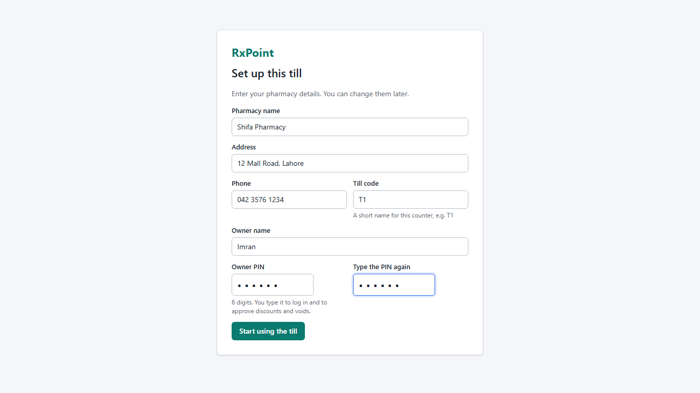

- **Till code** is a short name for this counter, such as `T1`. It starts every invoice
  number (`T1-000001`).
- **Owner PIN** must be 6 digits. See [PINs](#pins) for the rules.

Next, the till shows a **recovery code**. Write it down and keep it away from the till.
It is the only way back in if the owner forgets the PIN, and it is shown only once.

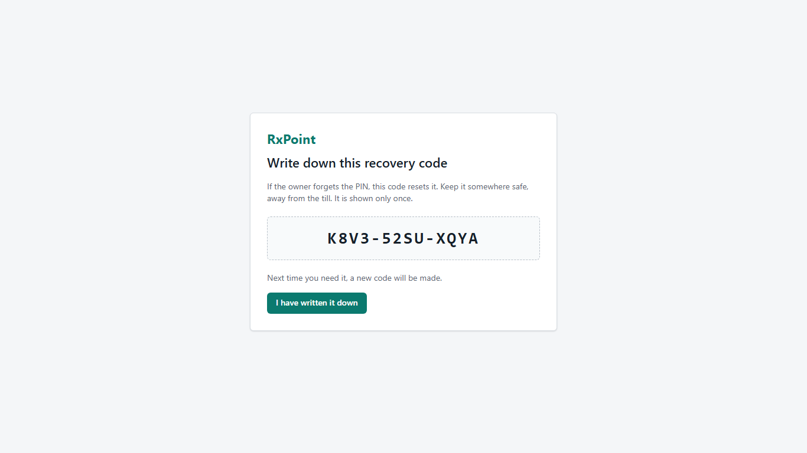

## 4. Logging in, locking and PINs

Pick your name, type your PIN and press Enter. A name marked **Locked** has had too many
wrong PINs; a name marked **No PIN yet** needs the owner to set one on **Staff**.

| Pick a name                                  | Type the PIN                    |
| -------------------------------------------- | ------------------------------- |
| 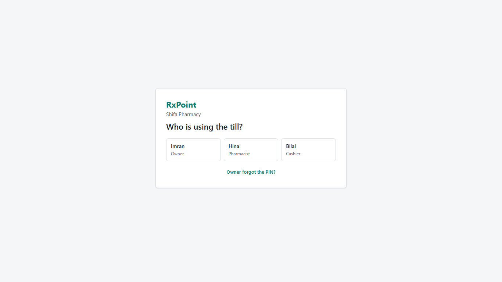 | 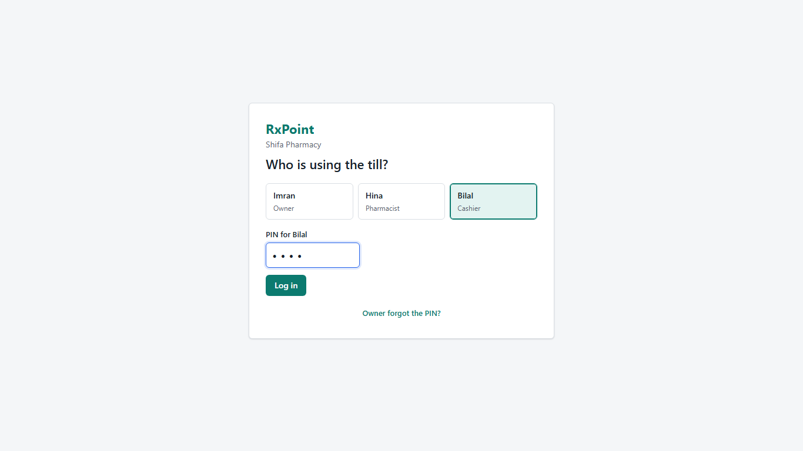 |

**Locking:** press **Ctrl+L** or the **Lock** button at the bottom left. The till also
locks itself after 5 minutes with no key press or click (the owner can change this on
**Settings**). A sale in progress is kept, and anyone who logs in carries on with it.

### PINs

- 4 to 6 digits; the owner's PIN is exactly 6.
- Easy PINs are refused: all one digit (`1111`) or a straight run (`1234`, `4321`).
- Each person keeps their own PIN private. Approvals are recorded under the name of the
  person whose PIN was typed.
- **Wrong PINs:** after 5 wrong PINs in a row the name is locked for 1 minute, after 10
  for 5 minutes, and after 15 (and every 5 more) for 15 minutes. The owner can press
  **Unlock** on **Staff** to clear it.
- **Owner forgot the PIN:** on the login screen press **Owner forgot the PIN?**, type the
  recovery code and choose a new PIN. A new recovery code is then shown; write it down.
- **Someone else forgot:** the owner presses **New PIN** next to their name on **Staff**.

## 5. Staff and roles

The owner adds people on **Staff** with **Add person**, picks their role and sets a first
PIN. **Edit** changes the role or switches the account off (**Can log in**); people are
never deleted, so their history stays.

| Add a person                          | The Staff screen           |
| ------------------------------------- | -------------------------- |
| 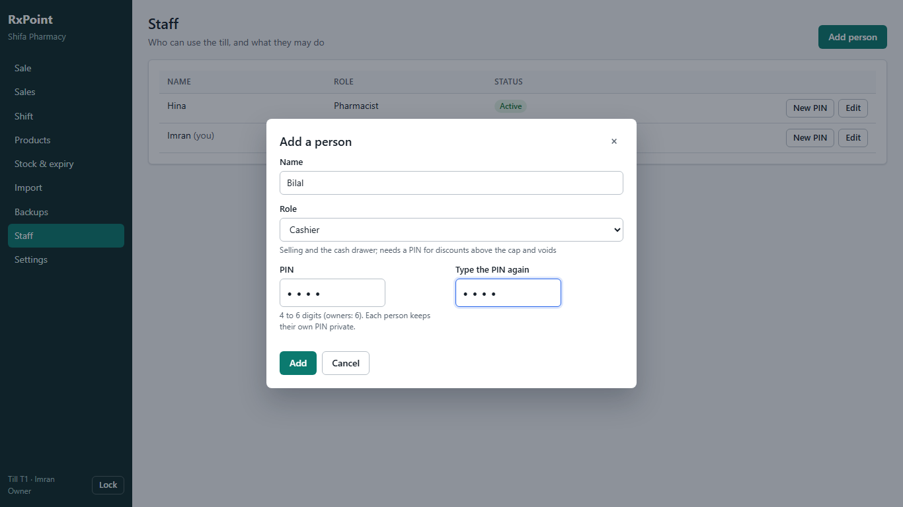 | 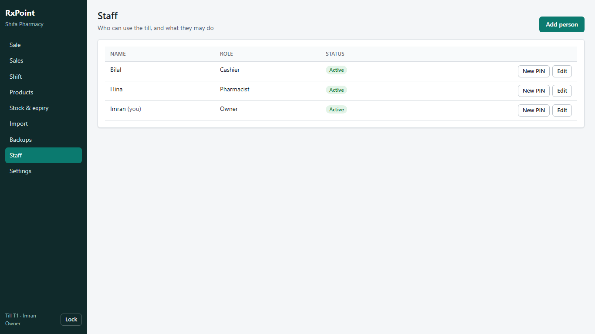 |

There are four roles:

| Role                | What they do                                                                                     |
| ------------------- | ------------------------------------------------------------------------------------------------ |
| **Owner**           | Everything, including staff, settings and (later) restoring backups.                             |
| **Pharmacist**      | Selling, approvals, voids and returns, controlled drugs, products and stock.                     |
| **Cashier**         | Selling and the cash drawer. Needs a PIN from a pharmacist or the owner for some things (below). |
| **Inventory clerk** | Products, stock and imports only. Cannot sell; starts on the Products screen.                    |

**Approvals:** when a cashier does something that needs more authority, the till asks for
a PIN from someone who may do it. **Approved by** lists only people who qualify (not the
person logged in); they choose their name and type their PIN on the till. An approval
covers that one thing only.

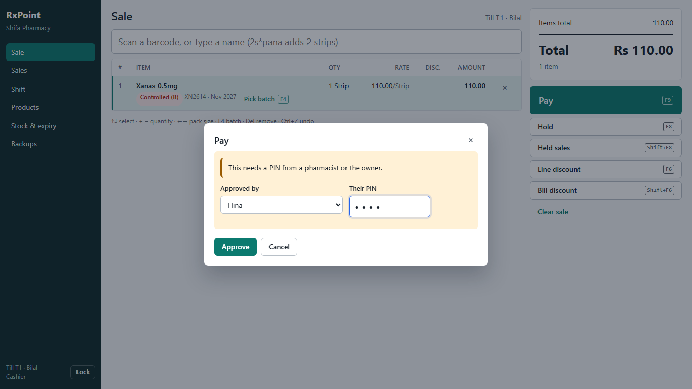

| Action                                      | Owner | Pharmacist  | Cashier                                 | Inventory clerk |
| ------------------------------------------- | ----- | ----------- | --------------------------------------- | --------------- |
| Sell, hold, show a receipt again            | Yes   | Yes         | Yes                                     | No              |
| Discount up to their limit                  | 100%  | 15%         | 5%                                      | No              |
| Discount above their limit                  | —     | Owner's PIN | Pharmacist's (up to 15%) or owner's PIN | No              |
| Sell a controlled drug                      | Yes   | Yes         | Pharmacist's or owner's PIN             | No              |
| Void a sale                                 | Yes   | Yes         | Pharmacist's or owner's PIN             | No              |
| Take items back (return)                    | Yes   | Yes         | Pharmacist's or owner's PIN             | No              |
| Return after the return window (7 days)     | Yes   | Owner's PIN | Owner's PIN                             | No              |
| Open and close a shift, cash in             | Yes   | Yes         | Yes                                     | No              |
| Cash out above the limit (Rs 2,000)         | Yes   | Yes         | Pharmacist's or owner's PIN             | No              |
| Open the drawer without a sale              | Yes   | Yes         | Pharmacist's or owner's PIN             | No              |
| See the expected cash before counting       | Yes   | Yes         | No (counts blind)                       | No              |
| Add and edit products, adjust stock, import | Yes   | Yes         | No (can look)                           | Yes             |
| Back up now                                 | Yes   | Yes         | Yes                                     | No              |
| Staff and Settings                          | Yes   | No          | No                                      | No              |

The discount limits, the cash-out limit and the return window are set on **Settings**.

## 6. Shifts and the cash drawer

Selling needs an open shift. Until one is open, the Sale screen says so and links to
**Shift**.

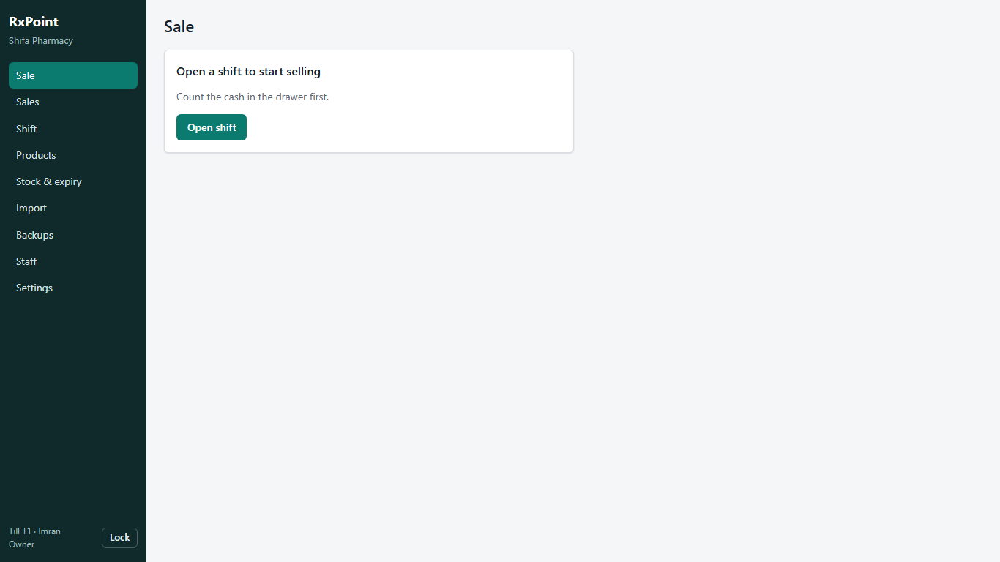

### Opening a shift

Count the cash in the drawer. The box starts with what the last shift left for the next
one (or the usual float, Rs 5,000). Type the total, or press **Count notes** to count by
note and let the till add it up.

| Typing the total                       | Counting notes                         |
| -------------------------------------- | -------------------------------------- |
| 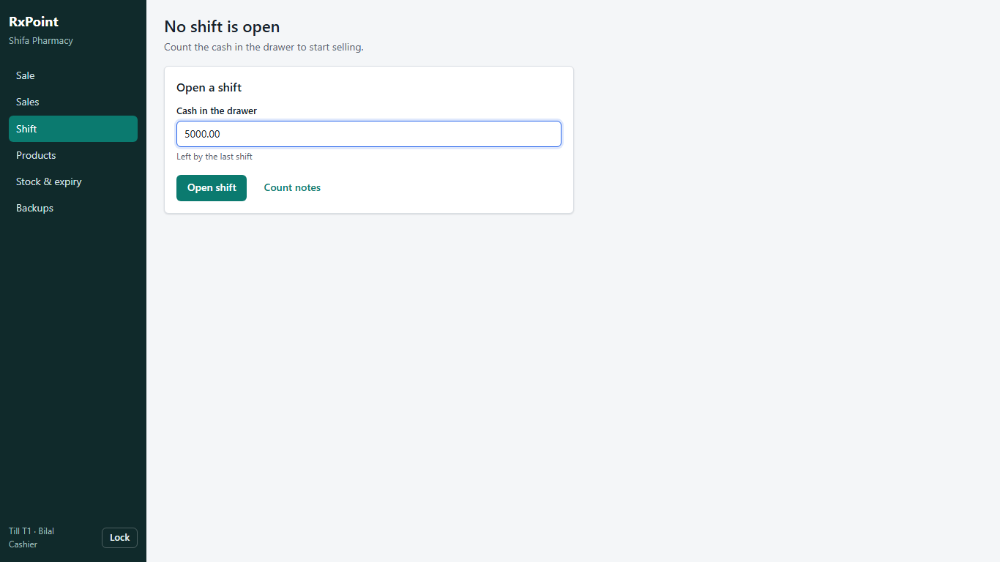 | 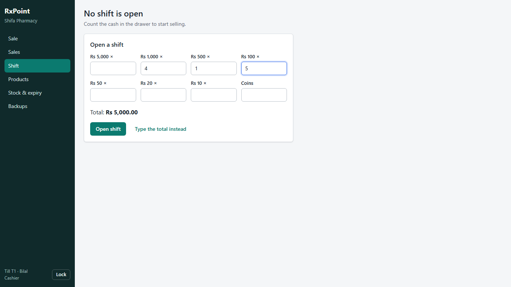 |

If the PC's date is more than 3 days after the last thing recorded on this till, the till
asks you to confirm today's date before the shift opens. Check the date on the PC clock
before pressing **Yes, today is …**: expiry checks depend on it.

### During the shift

The Shift screen shows the shift so far: sales, discounts, voids, returns, how each was
paid, cash in and out, and things to check (lines sold above MRP or without recorded
stock, prescriptions not seen, held sales). Cashiers don't see the expected cash until
they have counted.

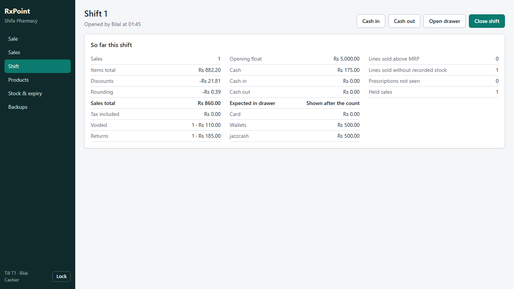

- **Cash in:** money put into the drawer (for example change from the bank).
- **Cash out:** money taken out. Choose what it was for (shop expense, paid a supplier,
  staff advance, owner took cash, bank deposit, change float, other) and add a note.
  More than Rs 2,000 needs a pharmacist's or the owner's PIN, and you can't take out more
  than should be in the drawer.
- **Open drawer:** open the drawer without a sale. It asks for a reason; cashiers need a
  pharmacist's or the owner's PIN.

The Sale screen has the same forms without leaving the sale: **Cash in/out** (Alt+C, with
an "In or out" choice that starts on Cash out) and **Open drawer** (Alt+D).

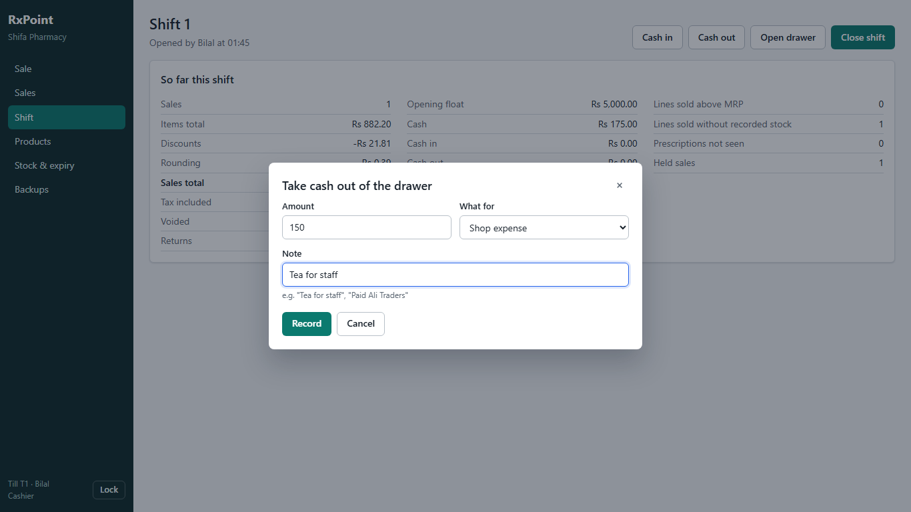

A shift open for more than 18 hours shows a warning: close it and open a new one.

### Closing a shift

1. Finish or hold the sale in progress first.
2. Press **Close shift** and count all the notes and coins.
3. **Leave in the drawer for the next shift** starts at the opening float. It can't be
   more than you counted.
4. Press **Close shift**. If the count is off by Rs 100 or more, the till says by how much
   and asks for a note before it closes.

| Counting the drawer                        | The count is short: add a note               |
| ------------------------------------------ | -------------------------------------------- |
| 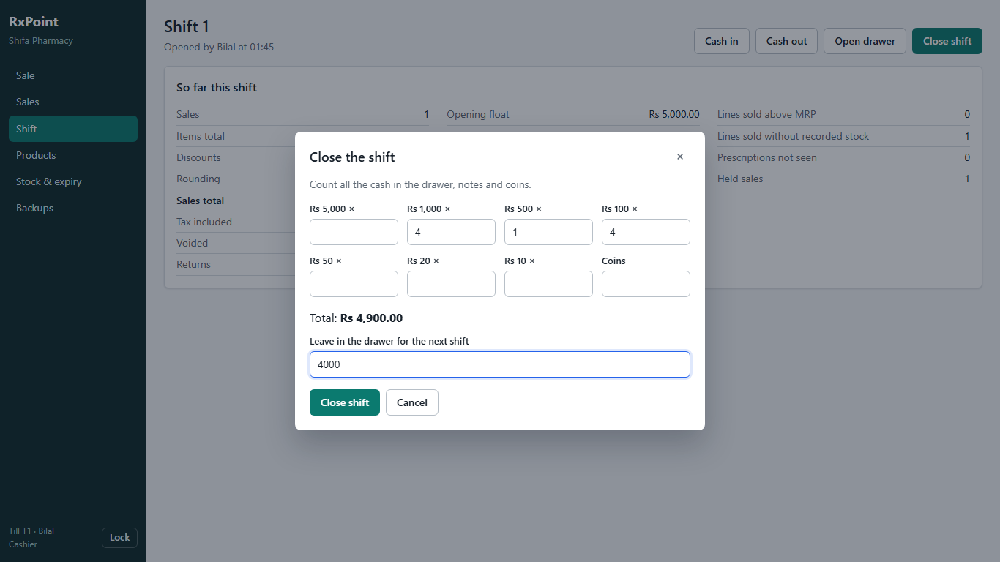 | 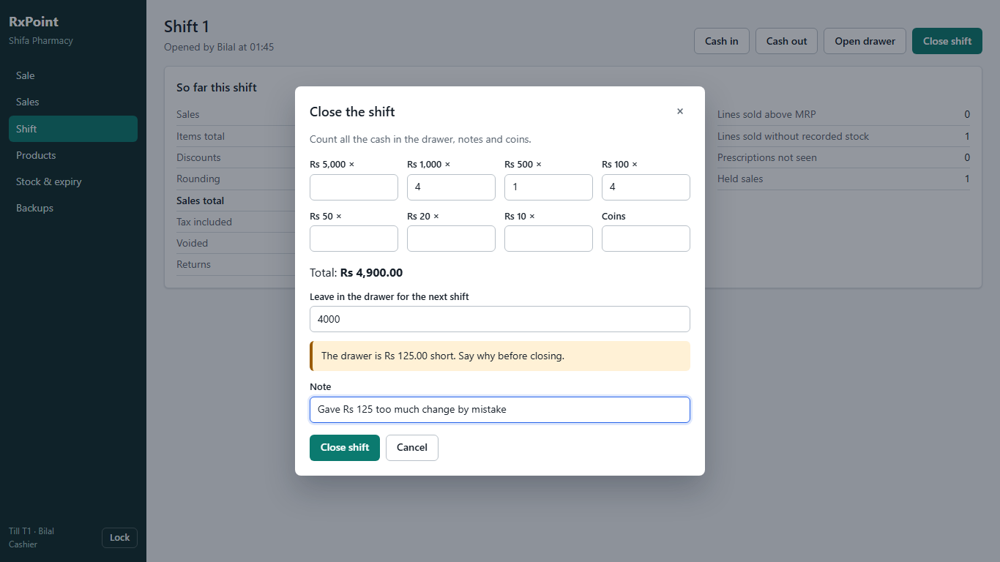 |

The shift report then shows the expected cash, what was counted and the difference. In
the desktop app the till also makes a backup. Press **Open next shift** when the next
person starts.

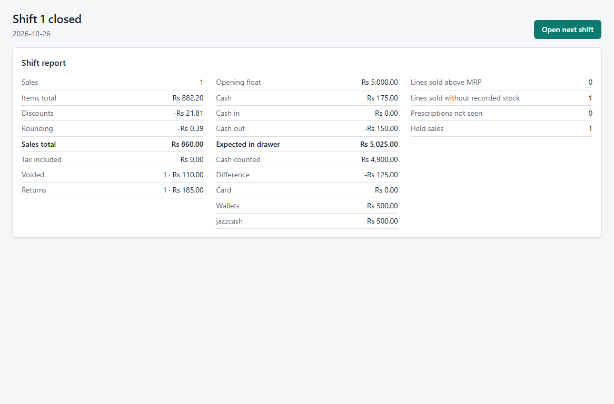

## 7. Selling

The Sale screen is the till's home screen. The cursor waits in the scan box.

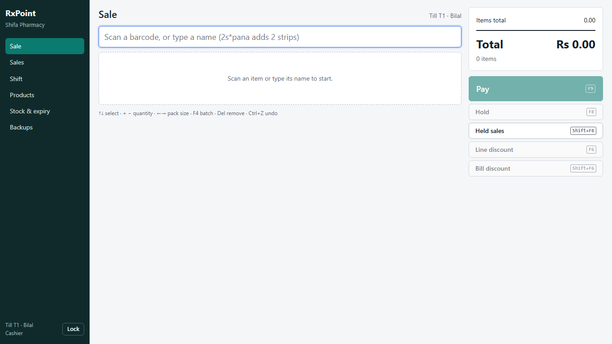

### Adding items

- **Scan** the barcode, or type it and press Enter. The pack that barcode belongs to is
  added (a box barcode adds a box).
- **Type part of the name, the salt or the strength** (at least 2 letters). Matches show
  with their stock and price; **↑ / ↓** moves, Enter adds the highlighted one. Items found
  by name are added in their smallest pack (a strip of tablets), or one at a time for
  things sold singly (a bottle, a tube).
- **Put the quantity first** with a star: `2s*pana` adds 2 strips of Panadol, `3*calpol`
  adds 3 bottles of Calpol, `2*8960000000011` adds 2 of the scanned pack.
- **Scanning the same item again** adds to its line instead of making a new one (unless
  that line has its own discount, price or batch).

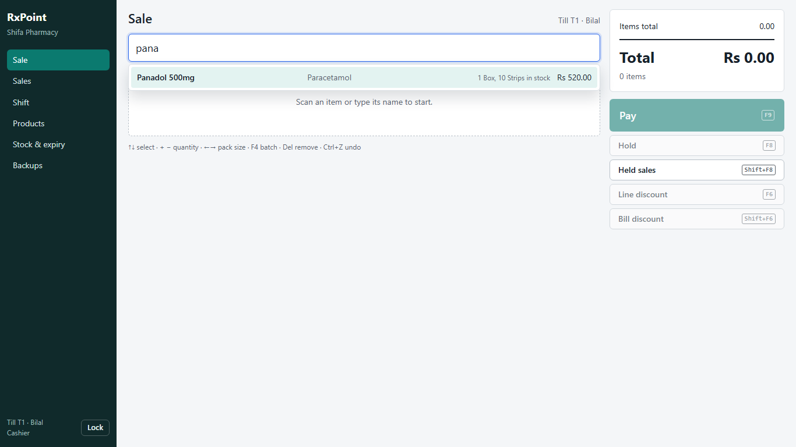

### The bill

Each line shows the quantity, the rate per pack, any discount and the amount. Under the
name are the batch the stock comes from and any warnings. The panel on the right shows the
total, with rounding, and the action buttons with their keys.

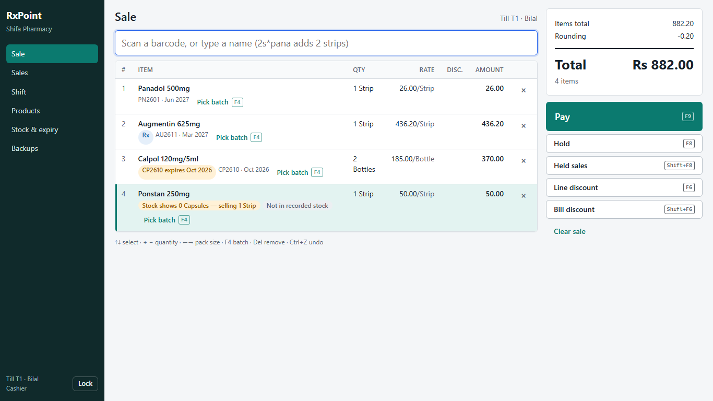

**Warnings on a line** (none of these stop the sale unless it says so):

| Chip                                            | Meaning                                                                                                                                                                                |
| ----------------------------------------------- | -------------------------------------------------------------------------------------------------------------------------------------------------------------------------------------- |
| **Rx** (blue)                                   | Prescription item. Pay asks whether the prescription was seen.                                                                                                                         |
| **Controlled (B)** or **(D)** (red)             | Controlled drug. Pick the batch on the pack, and fill in the prescription at Pay. Until the batch is picked there is no total. See [section 9](#9-controlled-drugs-and-prescriptions). |
| **CP2610 expires Oct 2026** (amber)             | That batch expires within 30 days. Check the pack.                                                                                                                                     |
| **Stock shows 0 — selling 1 Strip** (amber)     | Selling more than the till has on record. Allowed (sales never stop), and counted on the shift report.                                                                                 |
| **Not in recorded stock** (grey)                | Part of the line has no recorded batch.                                                                                                                                                |
| **Above MRP by Rs …** (amber)                   | The price is above the MRP printed on the batch. Press **Sell at MRP** (or Alt+M on the selected line) to bring it down, or carry on; it is counted on the shift report.               |
| **Expired stock on record** (red)               | The only stock on record has expired. Pay asks you to confirm the pack in hand is in date.                                                                                             |
| **Price now Rs …** (blue)                       | The price changed since the item was added (for example in a held sale).                                                                                                               |
| **Discount removed — more than the new amount** | The quantity went down and the discount no longer fits.                                                                                                                                |

**Changing a line:** click it (or use ↑ / ↓ with the scan box empty). Then **+ / −**
change the quantity, **← / →** change the pack size, **Delete** or **×** removes it and
**Ctrl+Z** brings it back. **Clear sale** (Ctrl+Shift+Delete) removes everything after
asking; the cleared items and total are logged.

Under the totals are **Last receipt** (Ctrl+P: this till's last receipt again, marked
`*** REPRINT ***`), **Cash in/out** (Alt+C) and **Open drawer** (Alt+D).

**The sale is saved as you go.** After a power cut or a restart, log in again and the till
says "The sale in progress was restored."

### Picking the batch (F4)

The till takes stock from the batch that expires first. To sell from a different batch,
select the line and press **F4** (or **Pick batch**). Expired batches are shown but can't
be picked. If a batch has less than the line needs, the till says the stock will go below
zero.

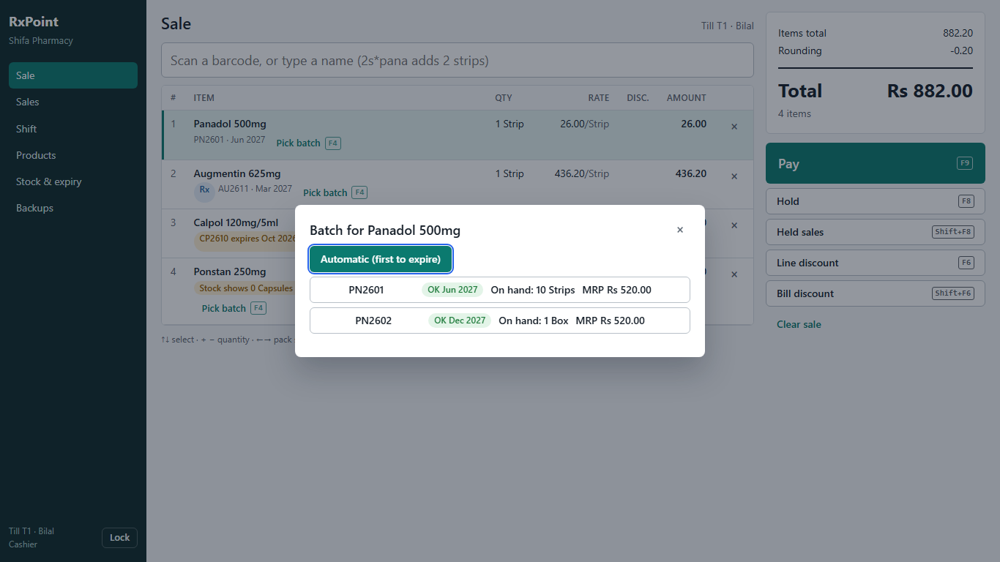

### Discounts (F6 and Shift+F6)

**F6** gives a discount on the selected line; **Shift+F6** on the whole bill. Type `10`
for 10% or `50/-` for Rs 50 off; the box shows the amount off and the new price. Type `0`
to remove it.

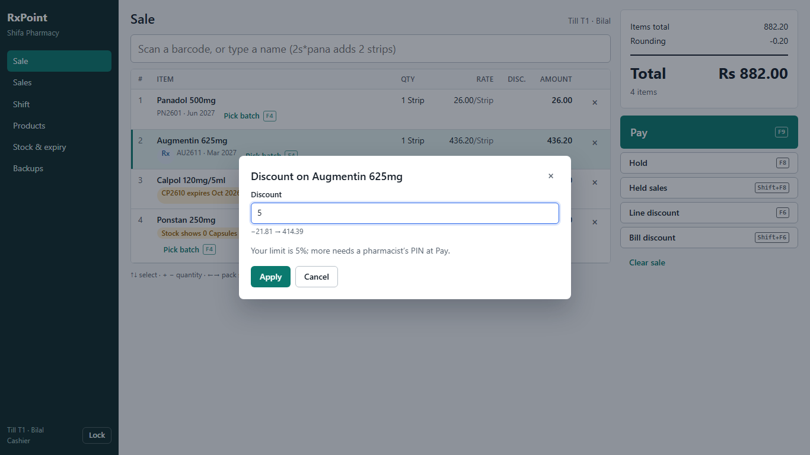

- Your limit is shown under the box (cashier 5%, pharmacist 15% unless the owner changed
  them). You can type more: Pay then asks for a PIN from someone allowed that much.
- Items marked "discounts not allowed" (formula milk, for example) never get one.
- If the owner set a store-wide discount on every item, it is already applied.

## 8. Paying

Press **F9** (or **Pay**). The total is shown in large type.

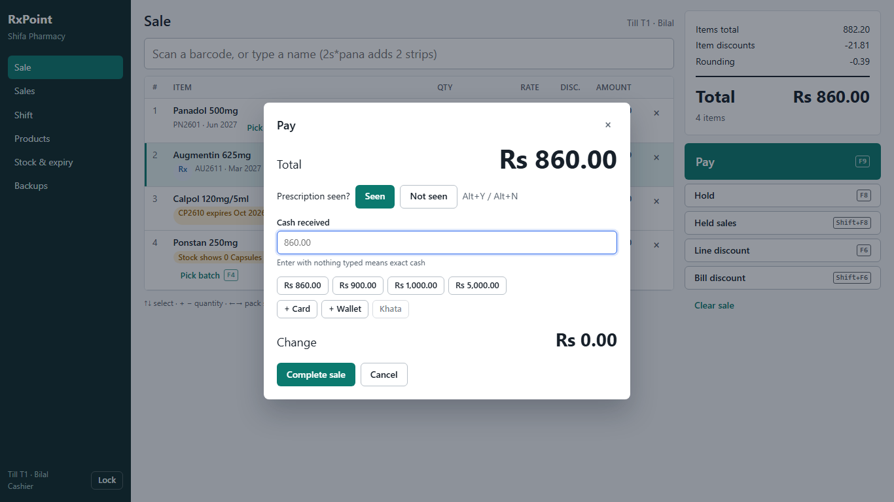

**Cash:** type the amount the customer gave and press Enter, or press one of the quick
amounts (exact, then the next Rs 100, 500, 1,000 and 5,000). Pressing Enter with the box
empty means exact cash. The change is shown as you type. An amount far above the bill
(more than Rs 5,000 over, or more than 10 times the bill) shows "looks like a typo".

**Card or wallet:** press **+ Card** (Alt+K) or **+ Wallet** (Alt+W). The amount starts
at what is still due, and the cursor moves to the new row.

- **Card:** the approval code from the card machine is optional.
- **Wallet** (JazzCash, Easypaisa, Raast): type the transaction ID (at least 4
  characters) and tick **Money received — I checked the app or SMS** after checking.
- **Split payments:** add as many as needed; cash covers the rest.
- Card and wallet together can't be more than the bill: only cash gives change.
- **Khata** is greyed out until customer accounts arrive.

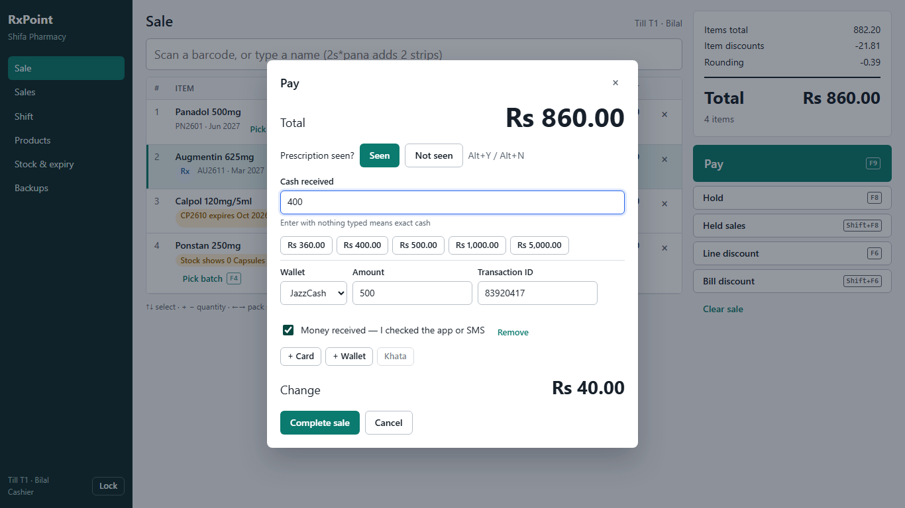

**Prescription seen?** appears when the bill has an Rx item. Answer **Seen** or **Not
seen** (Alt+Y / Alt+N). The owner can set the till to refuse "not seen".

**Expired stock on record:** if a line's only stock on record has expired, Pay first asks
whether the packs in hand are in date. Press **Yes, they are in date** only after checking
the pack; otherwise **Cancel** and remove the line.

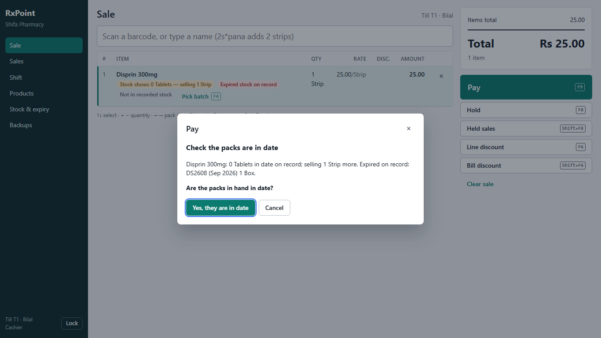

**Sale complete:** the change is shown in large type with the invoice number and the
receipt. Printing is off for now, so the receipt is shown on screen; open the drawer by
hand. Press Enter (or **New sale**) to start the next sale.

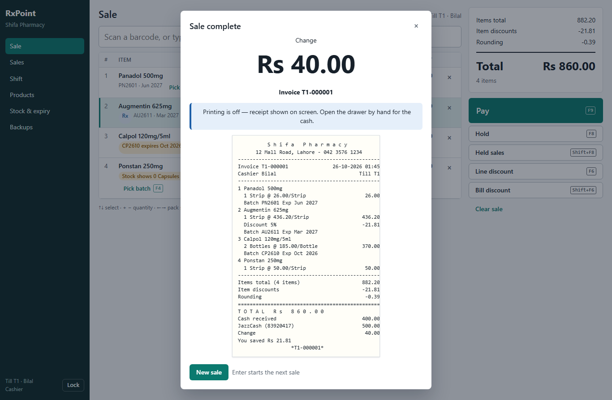

## 9. Controlled drugs and prescriptions

Controlled drugs (Punjab Drugs Rules, Schedules B and D) are marked **Controlled (B)** or
**(D)** and need three things before the sale can finish:

1. **The batch on the pack in hand.** Press **F4** and pick it. If the batch isn't listed,
   type the batch number, expiry and (optionally) MRP from the pack. An expired pack is
   refused.
2. **The prescription:** patient name and doctor, on the Pay dialog. One prescription per
   sale: items from a second prescription are rung up as a separate sale.
3. **A pharmacist's or the owner's PIN** when a cashier is selling.

| The line until the batch is picked                  | Picking the batch                                |
| --------------------------------------------------- | ------------------------------------------------ |
| 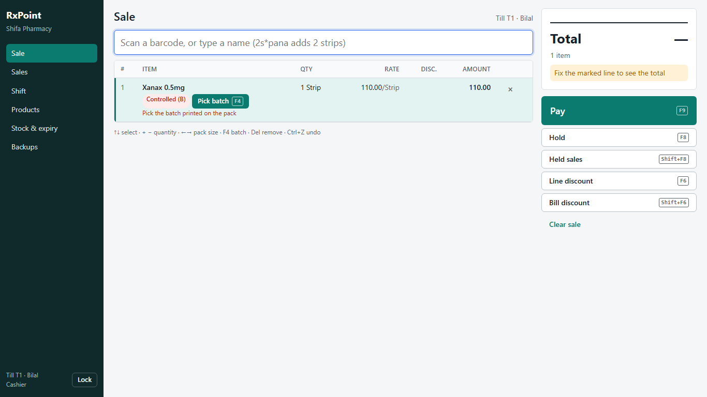 | 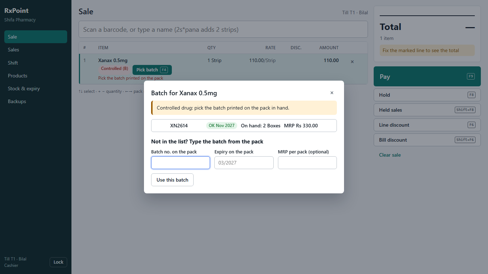 |

| Prescription at Pay                        | Receipt with the prescription               |
| ------------------------------------------ | ------------------------------------------- |
| 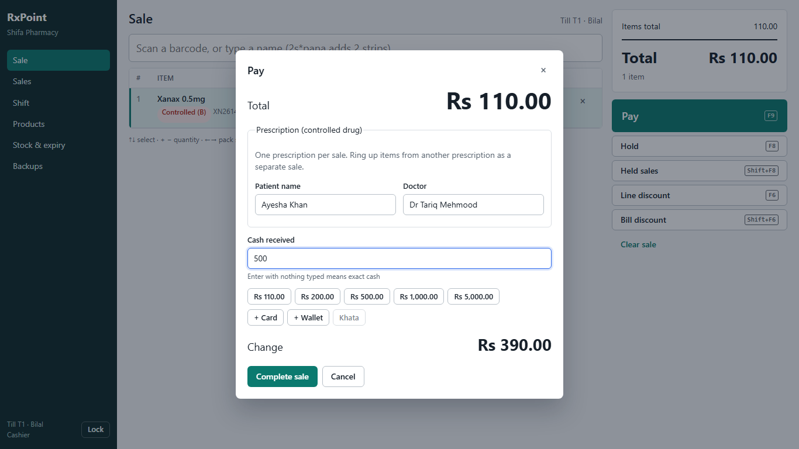 | 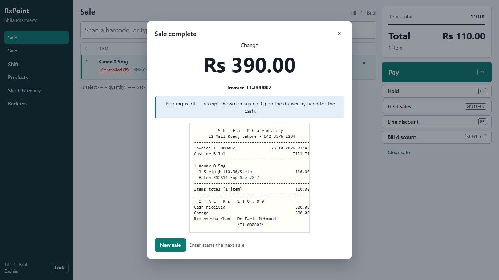 |

The receipt prints the batch and the patient and doctor's names.

## 10. Holding a sale

When a customer steps away (to fetch a prescription, or to the ATM), press **F8**, add a
note so you'll recognise them, and press **Hold**. The till starts a new sale at once.

| Hold (F8)                | Held sales (Shift+F8)          |
| ------------------------ | ------------------------------ |
| 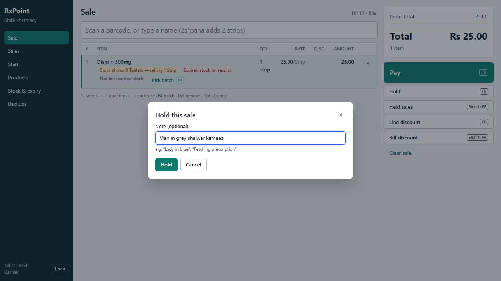 | 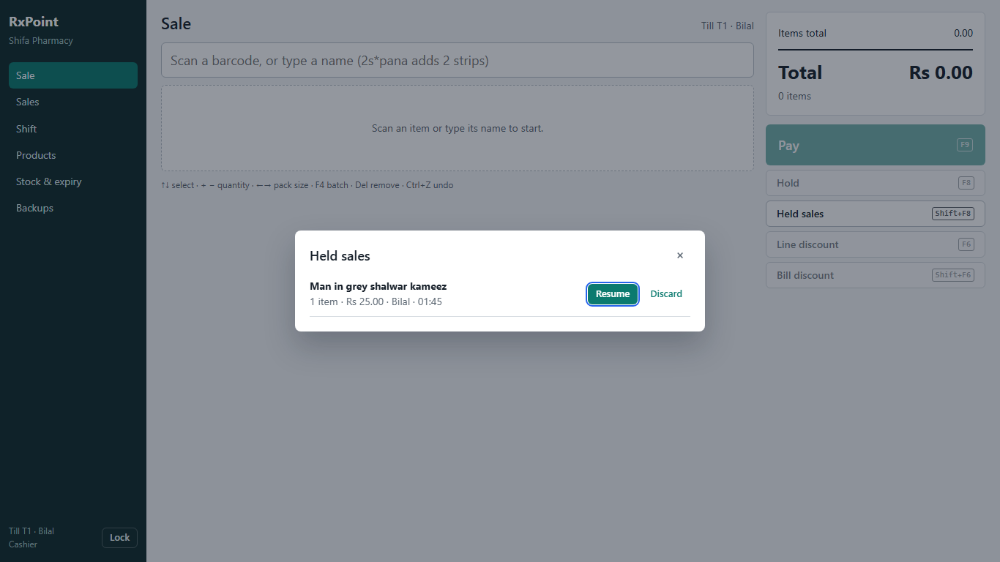 |

- **Shift+F8** lists held sales with the note, items, total, who held it and when.
  **Resume** brings one back; if another sale is in progress it is held first.
  **Discard** deletes a held sale after asking.
- Up to 10 sales can be on hold (Settings).
- Approvals given before holding don't carry over: ask again when you resume.
- Prices are checked again on resume; a changed price shows **Price now Rs …**.

## 11. Sales list, voids and returns

**Sales** lists this till's sales, newest first. Type an invoice number (`T1-000123` or
just `123`) to find one. Voided and returned sales are marked.

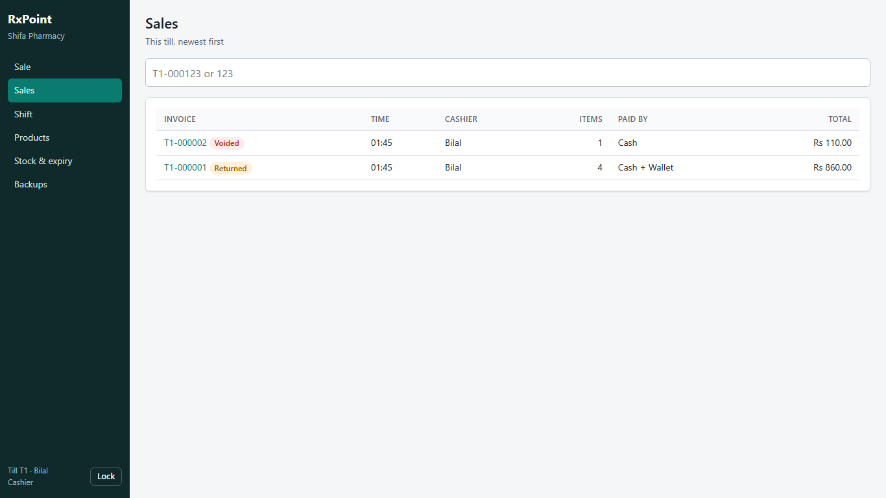

Click a sale to see its lines and what you can do with it:

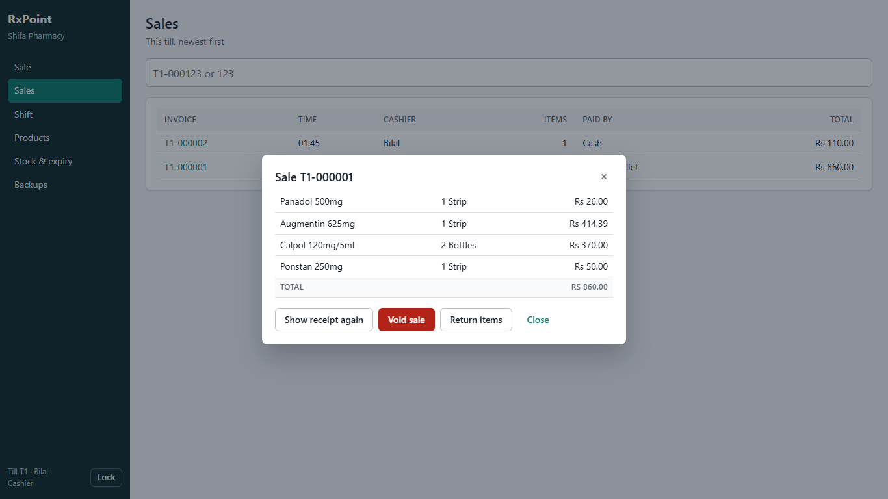

- **Show receipt again** shows the receipt marked `*** REPRINT ***`. For the last sale,
  **Ctrl+P** on the Sale screen does the same.
- **Void sale** cancels the whole sale.
- **Return items** takes some or all items back.

### Voiding a sale

Use a void for a mistake made in this shift ("rang up twice"). It needs a reason, and
cashiers need a pharmacist's or the owner's PIN. The stock goes back on the shelf and the
till tells you what to give back: cash from the drawer, or a card or wallet payment to
reverse.

| Void with approval       | Done                                 |
| ------------------------ | ------------------------------------ |
| 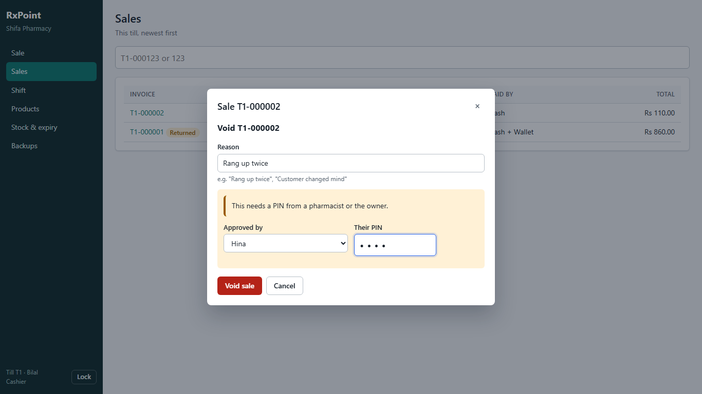 | 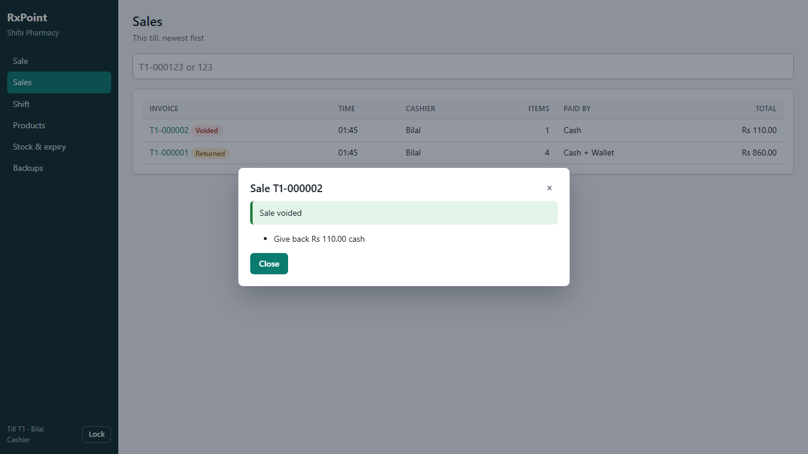 |

A sale can be voided only while its shift is open and only if nothing has been returned
from it. Otherwise, use a return.

### Returns

1. Type how many of each item are coming back (`1s`, `2t`, or a number, which counts the
   pack it was sold in). You can't return more than was sold, less anything already
   returned.
2. **Put back on shelf** is ticked, so the stock goes back. Untick it for damaged packs.
   A batch that has expired always stays off the shelf.
3. Choose **why it is coming back** (wrong item, doctor changed the medicine, side
   effect, damaged, expired, other) and add a note if useful.
4. **Pay back as** starts with the way the sale was paid. Card and wallet refunds can't be
   more than was paid that way, and cash refunds can't be more than is in the drawer.
   Refunds are rounded like the bill, so taking everything back refunds exactly what was
   paid.
5. Cashiers need a pharmacist's or the owner's PIN. A return more than 7 days after the
   sale needs the owner's PIN.
6. Press **Return and refund**. The till says what to give back and shows a return
   receipt.

| Return form                  | Return recorded                            |
| ---------------------------- | ------------------------------------------ |
| 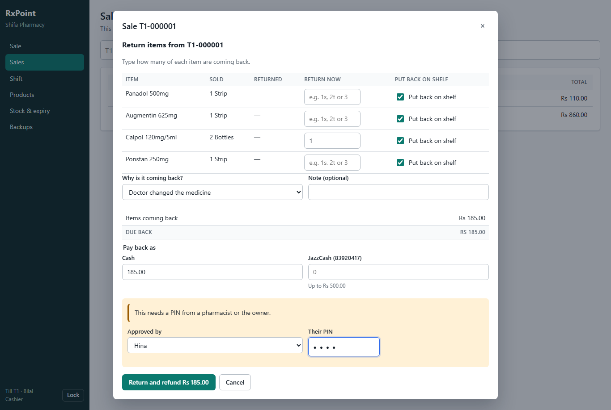 | 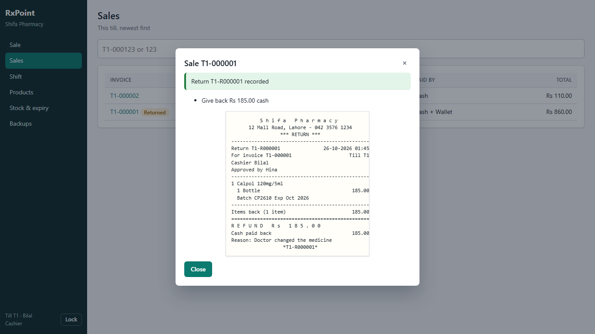 |

## 12. Products

**Products** lists everything the pharmacy sells with its price, stock and rack. Search by
brand, salt, strength or maker, or scan a barcode. **Rx** and **Controlled** are marked.
Tick **Show archived** to see products that are no longer sold.

| All products                     | Searching by salt                             |
| -------------------------------- | --------------------------------------------- |
| 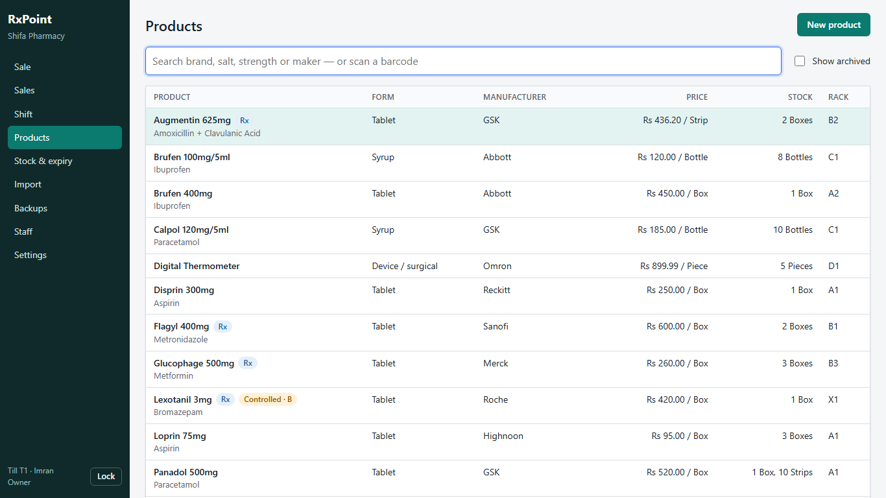 | 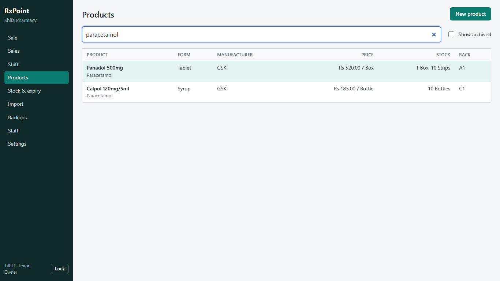 |

Click a product to see its salts, pack sizes, prices per pack, barcodes and stock by batch.

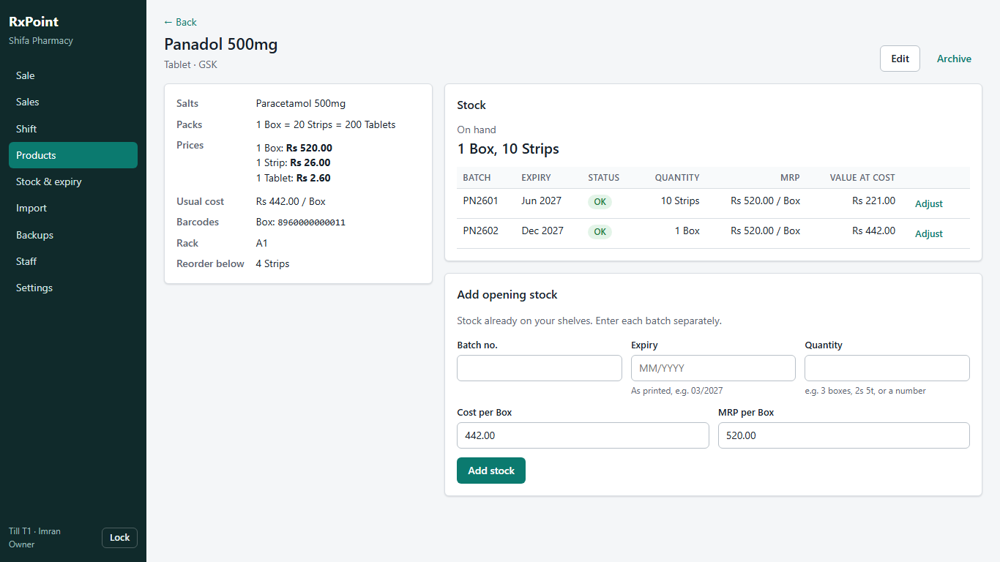

### Adding or editing a product

Press **New product**, or **Edit** on a product.

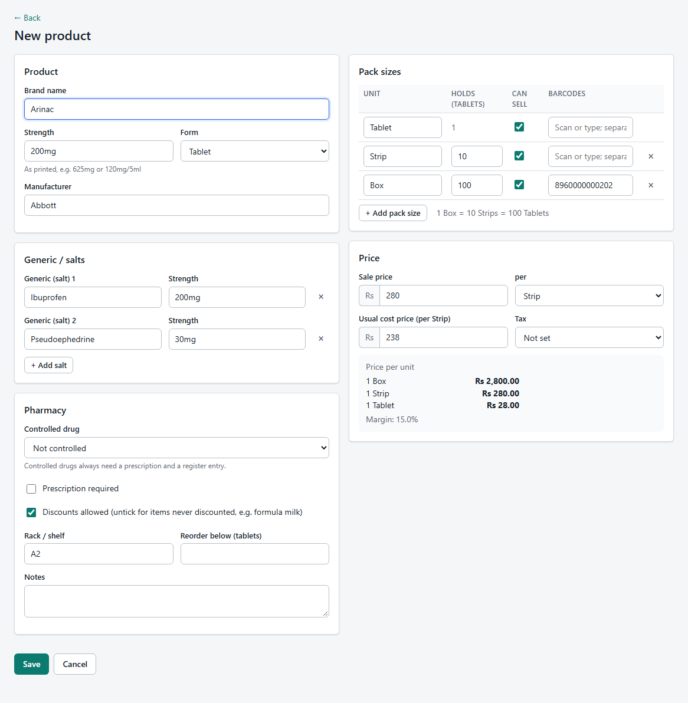

- **Product:** the brand name, strength as printed (`625mg`, `120mg/5ml`), form and
  manufacturer.
- **Generic / salts:** one row per salt with its strength. Staff can then find the product
  by its generic name.
- **Pack sizes:** the first row is the smallest unit, and stock is counted in it. Each
  other row says how many smallest units it **holds** (a strip holds 10 tablets, a box
  holds 100). Untick **Can sell** for packs not sold on their own. Scan each pack's
  barcode into its **Barcodes** box; several can be scanned in a row.
- **Price:** the sale price as printed, and which pack it is for. The till works out the
  price of every other pack and shows the margin against the usual cost price.
- **Pharmacy:** controlled drug schedule, prescription required, discounts allowed, rack
  or shelf, and a reorder level.
- Changing a price shows a box for the **reason** (for example "new DRAP price"). Every
  price change is recorded with who made it.
- **Archive** hides a product from search and selling but keeps its history. **Restore**
  brings it back. Products are never deleted.

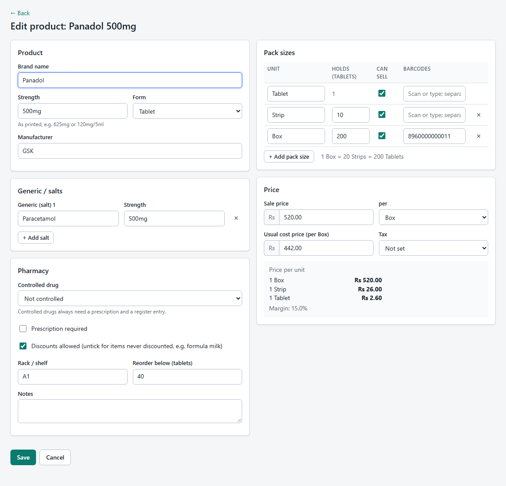

## 13. Stock and expiry

### Opening stock

For stock already on the shelves, use **Add opening stock** on the product's page. Enter
each batch separately: batch number, expiry as printed (`01/2028`), quantity (`5b`,
`3 boxes`, `2s 5t`), and the cost and MRP per pack (filled in from the product).

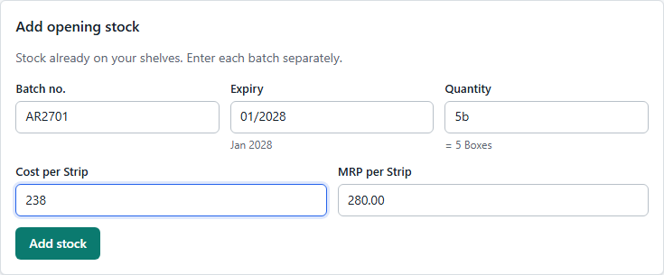

### Adjusting stock

Press **Adjust** next to a batch to add or remove stock with a reason (damaged, counted
wrong at opening). You can't remove more than the batch has. Every change is kept: stock
is never edited directly, only added or taken away with a record.

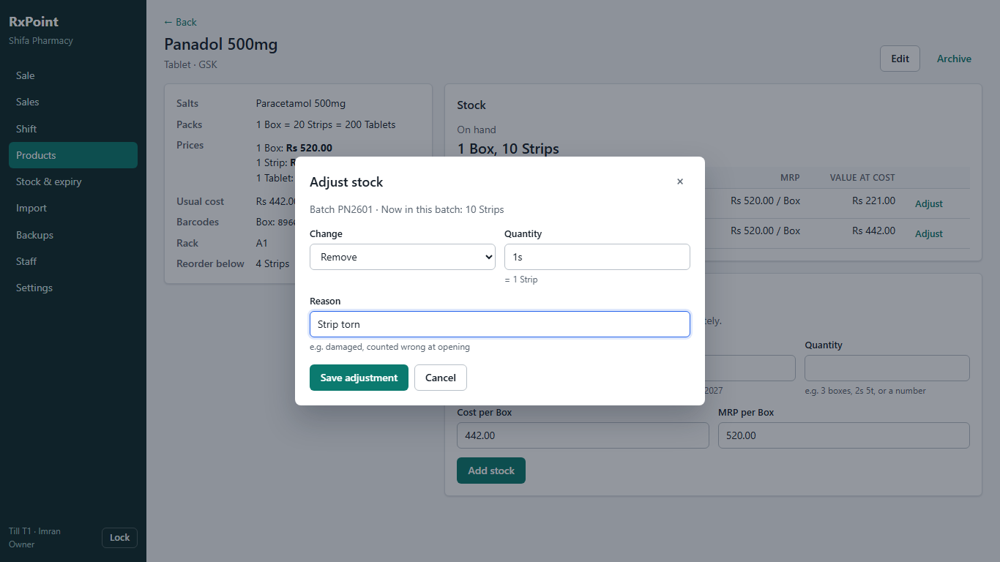

### The Stock & expiry screen

Shows the value of all stock at cost, the expired stock, and stock expiring in the next 90
days, then every batch with its days left. The tabs show **All stock**, **Expiring soon**
or **Expired**, and the box filters by product or batch.

| All stock                  | Expiring soon                               |
| -------------------------- | ------------------------------------------- |
| 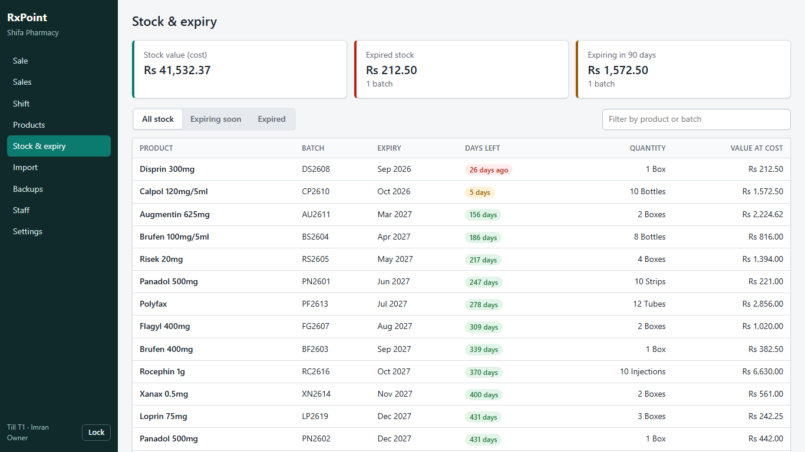 | 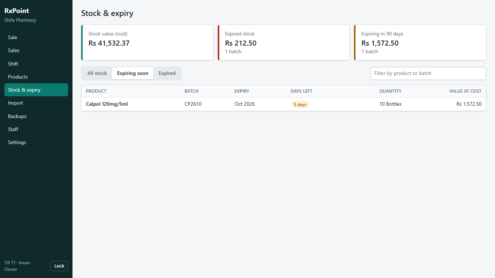 |

## 14. Importing a product list

**Import** brings in a product list from a spreadsheet saved as CSV. Rows can also carry
opening stock (batch, expiry, quantity). **Download template** gives a file with the right
columns. (**Load sample products** appears only in development builds.)

1. **Choose a file.**
2. **Match columns:** the till guesses which column is which; change any it got wrong.
   Only the product name is required.
3. **Check and import:** **Check rows** shows what will happen to each row without
   changing anything: **New**, **In catalog** (already there), **Same as row** (a second
   batch of a product above) or **Skipped** with the problem. Then press **Import**.

| Choose a file                              | Match columns                             |
| ------------------------------------------ | ----------------------------------------- |
| 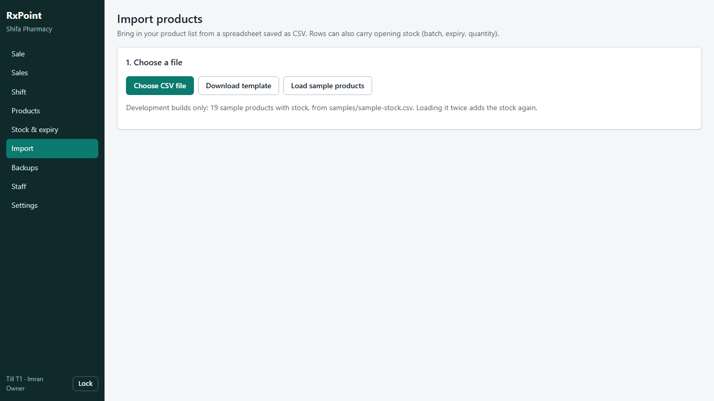 | 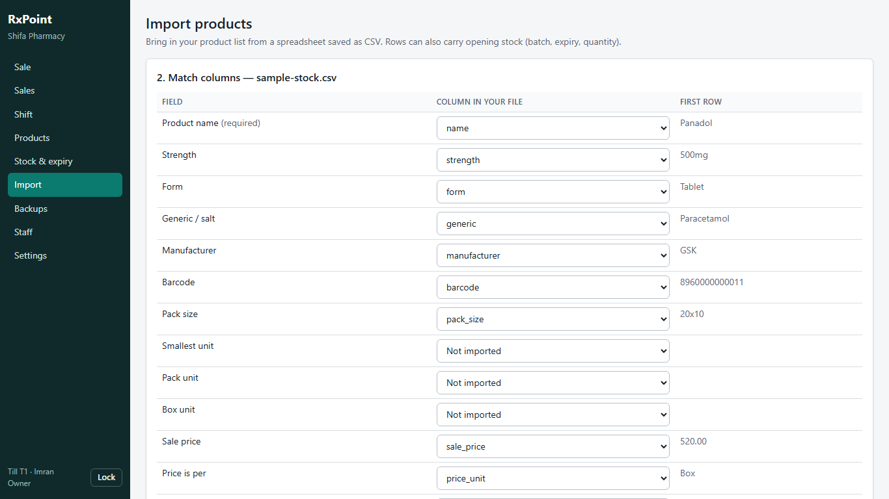 |

| Check rows                             | Done                                       |
| -------------------------------------- | ------------------------------------------ |
| 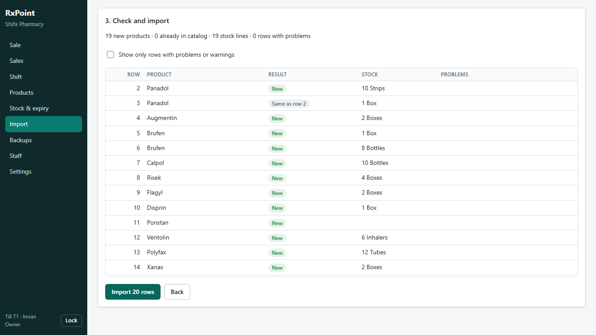 | 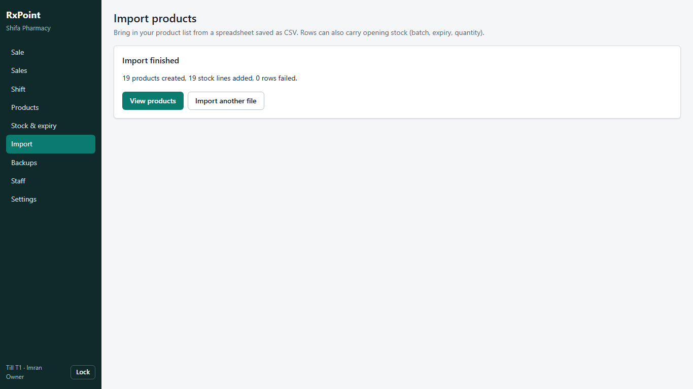 |

Products already in the catalog are not changed, but their stock lines are still added.
Importing the same file twice adds the stock twice.

## 15. Settings

The owner sets these for the whole pharmacy.

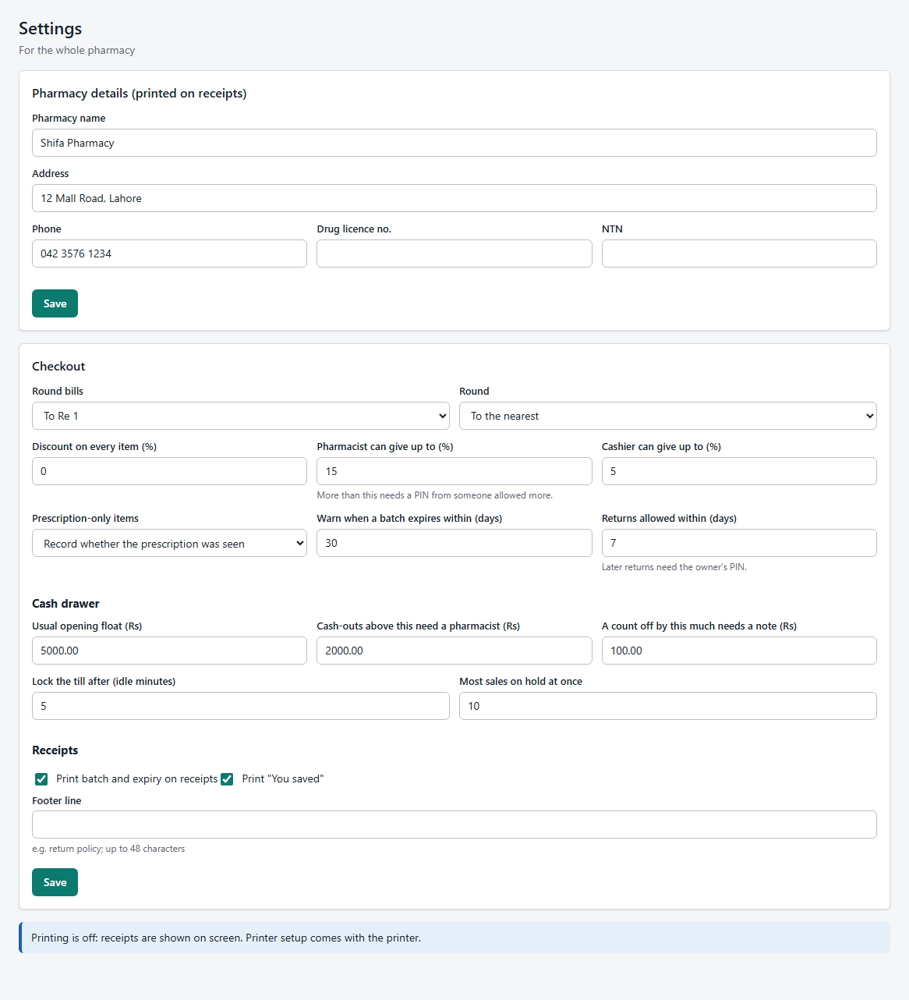

| Setting                                          | Default                 | What it does                                              |
| ------------------------------------------------ | ----------------------- | --------------------------------------------------------- |
| Pharmacy name, address, phone, drug licence, NTN | From setup              | Printed at the top of receipts.                           |
| Round bills / Round                              | To Re 1, to the nearest | No rounding, Re 1, Rs 5 or Rs 10; nearest or always down. |
| Discount on every item                           | 0%                      | A discount given on every item that allows one.           |
| Pharmacist / cashier can give up to              | 15% / 5%                | More needs a PIN from someone allowed more.               |
| Prescription-only items                          | Record whether seen     | Or require the prescription to be seen.                   |
| Warn when a batch expires within                 | 30 days                 | The expiry warning on the Sale screen.                    |
| Returns allowed within                           | 7 days                  | Later returns need the owner's PIN.                       |
| Usual opening float                              | Rs 5,000                | Suggested when no shift has left a float yet.             |
| Cash-outs above this need a pharmacist           | Rs 2,000                |                                                           |
| A count off by this much needs a note            | Rs 100                  | At shift close.                                           |
| Lock the till after                              | 5 idle minutes          | 1 to 60.                                                  |
| Most sales on hold at once                       | 10                      |                                                           |
| Print batch and expiry / Print "You saved"       | On / On                 | What the receipt shows.                                   |
| Footer line                                      | Empty                   | For example the return policy; up to 48 characters.       |

Every change to a setting is recorded with who made it.

## 16. Backups

Backups run in the desktop app (the browser preview keeps its data in the browser only).
The till copies its records:

- when someone logs in after a day without a backup,
- every 2 hours when there are new records, and
- when a shift closes.

Old copies are thinned to one a day for a month, then one a month. The **Backups** screen
shows the folder, the last good backup and every backup made, good or failed. Press
**Back up now** for an extra copy. If there has been no backup for over a day, the screen
says so. Restoring from a backup is coming in a later version.

## 17. Rules at a glance

**Selling never stops for stock:**

- Selling more than the stock on record warns but is allowed. It is counted on the shift
  report as "Lines sold without recorded stock".
- Selling above the batch's MRP warns but is allowed, with a one-press **Sell at MRP**.
- **Expired batches can't be sold.** If the only stock on record has expired, the till asks
  you to confirm the pack in hand is in date.
- Batches expiring within 30 days are flagged on the bill.
- Stock comes from the batch that expires first unless you pick one (F4).

**Money:**

- Bills are rounded to the nearest rupee (Settings can change this).
- Only cash gives change. Card and wallet payments can't be more than the bill.
- Wallet payments need a transaction ID and a tick that the money arrived.
- Discounts above your limit need a PIN at Pay.
- Refunds go back the way the sale was paid.

**Prescriptions and controlled drugs:**

- Rx items: say whether the prescription was seen. The owner can require it.
- Controlled drugs: the batch from the pack, the patient and doctor, and a pharmacist's
  PIN for cashiers. One prescription per sale.

**Shifts and cash:**

- No selling without an open shift; one shift at a time per till.
- Cash outs above Rs 2,000 and opening the drawer without a sale need a pharmacist's PIN
  for cashiers.
- Cashiers count the drawer blind. A difference of Rs 100 or more needs a note.

**Records:**

- Everything is saved the moment it happens and survives a power cut.
- Nothing is deleted. Products are archived, people are switched off, sales are voided or
  returned, and stock is adjusted with a reason.
- Prices, stock changes, discounts, voids, returns and approvals are recorded with who did
  them and who approved them.
- Keep the PC's date and time right: expiry checks depend on it.

## 18. Messages you may see

| Message                                                 | What to do                                                                             |
| ------------------------------------------------------- | -------------------------------------------------------------------------------------- |
| Open a shift to start selling                           | Go to **Shift** and open one.                                                          |
| Wrong PIN — 2 tries left                                | Check the name picked and type the PIN again.                                          |
| Too many wrong PINs. Try again at 14:10.                | Wait, or ask the owner to press **Unlock** on **Staff**.                               |
| Your account is switched off. Ask the owner.            | The owner can switch it back on with **Edit** on **Staff**.                            |
| No item has the barcode …                               | The barcode isn't on any product. Search by name, then add the barcode to the product. |
| Nothing matches "…"                                     | Try fewer letters, the salt name, or check the spelling.                               |
| … is archived — ask the owner                           | The product was archived. The owner can **Restore** it on its page.                    |
| Can't read that quantity; try 2s or 1b 2s               | Type the quantity again; see [Typing quantities](#typing-quantities-money-and-dates).  |
| Fix the marked line to see the total                    | A line needs something, usually a controlled drug's batch (F4).                        |
| Card and wallet can't be more than the bill             | Lower the card or wallet amount; take the rest in cash.                                |
| Enter the transaction ID (at least 4 characters)        | Copy it from the customer's app or SMS.                                                |
| … looks like a typo. Check the amount.                  | The cash typed is far above the bill. Check it before completing.                      |
| The total is now Rs … — check the bill                  | A price changed while paying. Check the bill and pay again.                            |
| 10 sales are already held. Finish or discard one first. | Press **Shift+F8** and finish or discard one.                                          |
| There isn't that much cash in the drawer                | The cash out or refund is more than the drawer should hold.                            |
| Hold or finish the sale in progress first               | Before closing the shift, complete or hold the sale on the Sale screen.                |
| This sale is from a closed shift — use a return         | Voids are only for the current shift. Use **Return items**.                            |
| Part of this sale was returned — use a return           | Return the rest instead of voiding.                                                    |
| Is today really …? The last record was … days ago.      | Check the PC's date. Confirm only if it is right.                                      |

## 19. Known issues

- After a void or a return, the steps name a wallet in small letters ("Reverse the Rs 500.00
  jazzcash payment").

## 20. Updating this guide

The screenshots are taken by a script that walks through the till with the sample stock,
so they can be redone after a screen changes:

```sh
pnpm docs:screenshots
```

It starts its own preview server on port 1430, sets up a fresh till, and writes the
pictures to `docs/user-guide/images/` (the script is
`apps/till/e2e/guide-screenshots.ts`). It is not part of `pnpm test:e2e`. Dates on the
pictures come from the PC's clock. Check this guide still matches after re-running it.

The keys in [section 2](#2-keyboard-shortcuts) match the F1 list (`S.help` in
`apps/till/src/strings.ts`). When a key changes, change both: a unit test
(`apps/till/src/app/help.test.ts`) fails if a key in the F1 list is missing here.
